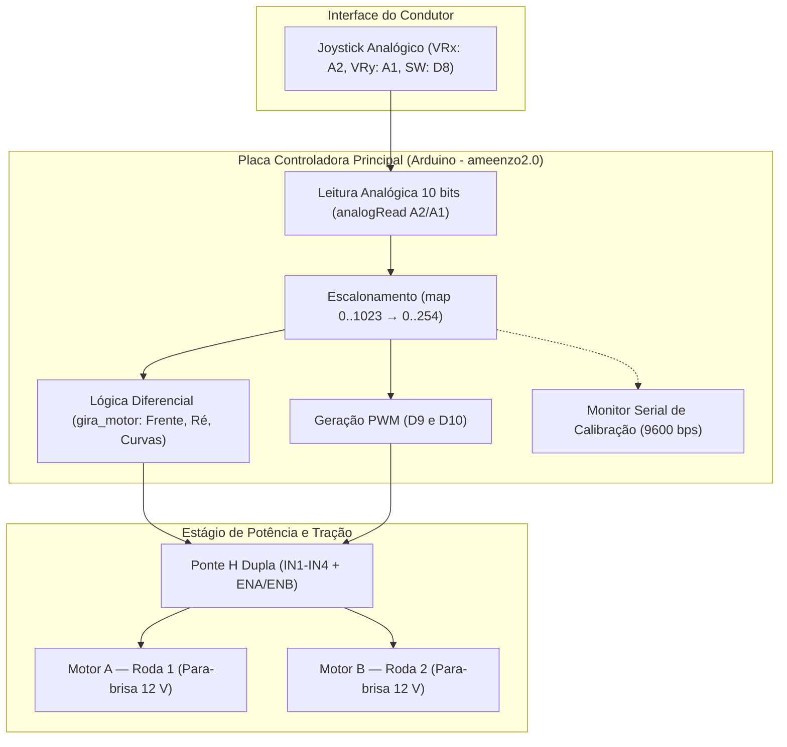
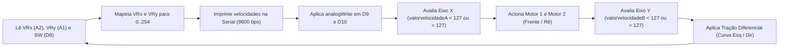

# AmeEnzo 2.0 — Cadeira de Rodas Motorizada Assistiva com Arduino

Firmware embarcado em **Arduino** desenvolvido para a motorização de baixo custo de uma cadeira de rodas infantil voltada a uma criança com **Esclerose Lateral Amiotrófica (ELA)**, empregando **tração diferencial independente com dois motores DC de limpador de para-brisa**, acionamento bidirecional via **Ponte H dupla com controle PWM** e condução de baixo esforço físico por **joystick analógico de dois eixos**.

[-1F3A5F?style=flat-square)](#objetivo)
[-2B4C7E?style=flat-square)](#hardware-e-mapeamento-de-pinos)

O projeto nasceu com propósito social e de engenharia assistiva: adaptar uma cadeira de rodas convencional em uma plataforma motorizada acessível, utilizando o Arduino como unidade central de processamento para traduzir movimentos suaves de um joystick em comandos de direção e velocidade nas duas rodas motrizes.

---

## Sumário

1. [Objetivo](#objetivo)
2. [Justificativa Técnica](#justificativa-técnica)
3. [Cenários de Uso](#cenários-de-uso)
4. [Arquitetura do Sistema](#arquitetura-do-sistema)
5. [Hardware e Mapeamento de Pinos](#hardware-e-mapeamento-de-pinos)
6. [Lógica de Controle Diferencial e Tabela Verdade](#lógica-de-controle-diferencial-e-tabela-verdade)
7. [Recomendações de Segurança e Estrutura do Repositório](#recomendações-de-segurança-e-estrutura-do-repositório)
8. [Contato](#contato)
9. [Stack Técnica e Tecnologias Utilizadas](#stack-técnica-e-tecnologias-utilizadas)

---

## Objetivo

Viabilizar o controle eletrônico de locomoção de uma cadeira de rodas motorizada adaptada de baixo custo, cumprindo os seguintes objetivos funcionais:

- Ler continuamente os dois eixos potenciométricos (`VRx` e `VRy`) e a chave integrada (`SW`) de um **joystick analógico**, exigindo força muscular mínima do condutor.
- Converter os sinais analógicos (`0–1023`) em comandos de **velocidade por PWM (`0–254`)** e **sentido de rotação** para dois canais independentes de Ponte H.
- Permitir manobras de **avanço, marcha à ré e curvas por tração diferencial** atuando sobre dois motores DC automotivos acoplados individualmente às rodas.
- Expor os valores convertidos pela porta serial (`9600 bps`) para calibração rápida do ponto neutro e dos limites do joystick em bancada.

---

## Justificativa Técnica

Cadeiras de rodas motorizadas comerciais possuem custo elevado e manutenção restrita, o que frequentemente dificulta o acesso rápido de famílias com crianças em condição neuromuscular progressiva. As decisões de hardware e software adotadas neste projeto equilibram **acessibilidade financeira, torque mecânico e simplicidade de manutenção**:

- **Motores DC de limpador de para-brisa automotivo (`12 V`):** oferecem caixa de redução integrada do tipo coroa e parafuso sem-fim, entregando **alto torque em baixa rotação** e efeito natural de **autofrenagem mecânica** quando desenergizados — característica altamente desejável para evitar deslocamento involuntário em pisos levemente inclinados.
- **Tração diferencial com Ponte H dupla + PWM:** controlar cada roda independentemente por meio de dois sinais lógicos de sentido (`IN1/IN2` e `IN3/IN4`) e dois canais PWM (`D9` e `D10`) dispensa caixa de direção mecânica complexa e permite curvas de raio reduzido em ambientes internos.
- **Interface de condução por joystick analógico:** demanda mínima amplitude articular e baixa força de acionamento, sendo adequada a usuários com mobilidade reduzida nos membros superiores, além de disponibilizar o botão central `SW` (`INPUT_PULLUP`) para funções auxiliares (como parada ou sinal sonoro).
- **Arduino como unidade controladora modular:** plataforma amplamente disponível, de baixo custo e fácil reprogramação para ajustar sensibilidade, velocidade máxima e parâmetros ergonômicos conforme a evolução das necessidades da criança.

---

## Cenários de Uso

- **Tecnologia assistiva personalizada:** motorização acessível de cadeiras de rodas infantis ou juvenis para pacientes com ELA, atrofias musculares ou mobilidade severamente reduzida.
- **Projetos acadêmicos e iniciativas comunitárias de reabilitação:** referência prática de controle diferencial de dois motores DC de alto torque com Arduino, ponte H e joystick analógico.
- **Plataformas móveis educacionais e robótica de tração diferencial:** base de código simples para testes de bancada com pontes H duplas, leitura analógica ADC e calibração serial de joysticks.

---

## Arquitetura do Sistema

### Fluxo do Laço de Controle (`loop()`)

---

## Hardware e Mapeamento de Pinos

### Mapeamento de Entradas e Saídas (Arduino Uno / Nano — ATmega328P)

| Pino Arduino | Variável no Código | Direção | Função / Conexão |
| :--- | :--- | :--- | :--- |
| `A2` | `pinVRx` | Entrada Analógica | Eixo X do joystick (avanço / marcha à ré) |
| `A1` | `pinVRy` | Entrada Analógica | Eixo Y do joystick (esterçamento lateral) |
| `D8` | `pinSW` | Entrada (`INPUT_PULLUP`) | Botão central do joystick (leitura em `statusSW`) |
| `D2` | `IN1` | Saída Digital | Controle de sentido 1 do **Motor A** na Ponte H |
| `D4` | `IN2` | Saída Digital | Controle de sentido 2 do **Motor A** na Ponte H |
| `D9` *(PWM)* | `velocidadeA` | Saída PWM | Modulação de velocidade do **Motor A** (`ENA` da Ponte H) |
| `D6` | `IN3` | Saída Digital | Controle de sentido 1 do **Motor B** na Ponte H |
| `D7` | `IN4` | Saída Digital | Controle de sentido 2 do **Motor B** na Ponte H |
| `D10` *(PWM)* | `velocidadeB` | Saída PWM | Modulação de velocidade do **Motor B** (`ENB` da Ponte H) |
| `USB (TX/RX)` | `Serial` | UART | Saída de depuração e calibração a `9600 bps` |

> [!NOTE]
> **Atenção aos pinos PWM ativos:** comentários de versões anteriores no cabeçalho do arquivo citam os pinos `3` e `5`, mas as atribuições efetivamente compiladas e utilizadas no firmware são `velocidadeA = 9` (`D9`) e `velocidadeB = 10` (`D10`), ambos canais PWM nativos do Timer1 no Arduino Uno/Nano.

---

## Lógica de Controle Diferencial e Tabela Verdade

### 1. Tabela Verdade da Ponte H (`gira_motor(motor, sentido)`)

| Parâmetro `sentido` | `IN1` / `IN3` | `IN2` / `IN4` | Estado do Motor |
| :---: | :---: | :---: | :--- |
| `0` *(ou outro)* | `LOW` (`0 V`) | `LOW` (`0 V`) | Desligado / Parado |
| `1` | `LOW` (`0 V`) | `HIGH` (`5 V`) | Rotação em sentido horário |
| `2` | `HIGH` (`5 V`) | `LOW` (`0 V`) | Rotação em sentido anti-horário |
| — *(proteção)* | `HIGH` (`5 V`) | `HIGH` (`5 V`) | Desligado / Freio dinâmico *(evitado pela função)* |

### 2. Comandos de Tração Diferencial no `loop()`

Os valores analógicos (`0–1023`) são convertidos para `0–254` (ponto neutro nominal em `127`):

| Condição do Joystick | Motor 1 (`gira_motor(1, ...)`) | Motor 2 (`gira_motor(2, ...)`) | Manobra Resultante |
| :--- | :---: | :---: | :--- |
| `valorvelocidadeA < 127` | Sentido `1` | Sentido `1` | Deslocamento para frente |
| `valorvelocidadeA > 127` | Sentido `2` | Sentido `2` | Deslocamento em marcha à ré |
| `valorvelocidadeB < 127` | Sentido `1` | Desligado (`0`) | Curva diferencial (pivô na Roda 2) |
| `valorvelocidadeB > 127` | Desligado (`0`) | Sentido `1` | Curva diferencial (pivô na Roda 1) |

---

## Recomendações de Segurança e Estrutura do Repositório

> [!IMPORTANT]
> **Recomendações essenciais para uso assistivo em campo:**
> 1. **Zona morta (*deadzone*) e mixagem proporcional:** o firmware atual constitui a versão funcional base de acionamento direto em torno de `127`. Para operação assistiva contínua, recomenda-se adicionar uma **zona morta calibrável** no centro do joystick (ex.: `±15` pontos), calcular o PWM proporcional ao deslocamento a partir do centro (`abs(valor - 127) * 2`) com rampa suave de aceleração/frenagem e desativar ambos os motores quando o joystick estiver em repouso.
> 2. **Isolamento de carcaça dos motores de para-brisa:** muitos motores automotivos de limpador de para-brisa conectam internamente uma das escovas à carcaça metálica. Antes de ligá-los a uma **Ponte H reversível**, verifique continuidade entre escovas e carcaça e isole o motor do chassi metálico da cadeira para evitar curto-circuito na inversão de polaridade.
> 3. **Dimensionamento de potência e corte de emergência:** utilize pontes H adequadas à corrente de pico/partida de motores de para-brisa (ex.: drivers de alta corrente como `BTS7960 43A` ou estágio MOSFET dedicado), fusível principal próximo à bateria `12 V` e **chave física de parada de emergência (*kill switch*)** acessível ao cuidador.

> [!NOTE]
> **Abertura na Arduino IDE:** o arquivo de firmware está salvo como [ameenzo2.0](./ameenzo2.0) (sem extensão `.ino`). Para abrir e gravar pela Arduino IDE, salve uma cópia como `ameenzo2_0.ino` dentro de uma pasta de nome `ameenzo2_0`.

### Estrutura de Arquivos

| Arquivo | Descrição |
| :--- | :--- |
| [ameenzo2.0](./ameenzo2.0) | Código-fonte Arduino de leitura do joystick analógico, mapeamento de velocidade PWM e acionamento diferencial dos dois motores via Ponte H |
| [README.md](./README.md) | Documentação técnica, contexto assistivo, arquitetura, mapeamento de pinos e recomendações de segurança |

---

## Contato

- **Autor:** Aislan Silva Costa
- **E-mail:** [comprasaislan@gmail.com](mailto:comprasaislan@gmail.com)
- **LinkedIn:** [linkedin.com/in/aislan-silva-costa-660814341](https://www.linkedin.com/in/aislan-silva-costa-660814341/)

---

## Stack Técnica e Tecnologias Utilizadas

| Categoria | Itens |
| :--- | :--- |
| **Hardware** | `Arduino (ATmega328P)` `2x Motor DC Limpador de Para-brisa (12 V)` `Ponte H Dupla` `Joystick Analógico 2 Eixos + Botão (SW)` `Bateria 12 V` |
| **Protocolos** | `PWM (analogWrite)` `Entrada Analógica ADC (10 bits)` `GPIO Digital` `UART (Serial 9600 bps)` |
| **Tecnologias** | `C++ (Arduino)` `Tração Diferencial` `Tecnologia Assistiva` `Controle de Motores DC` |
